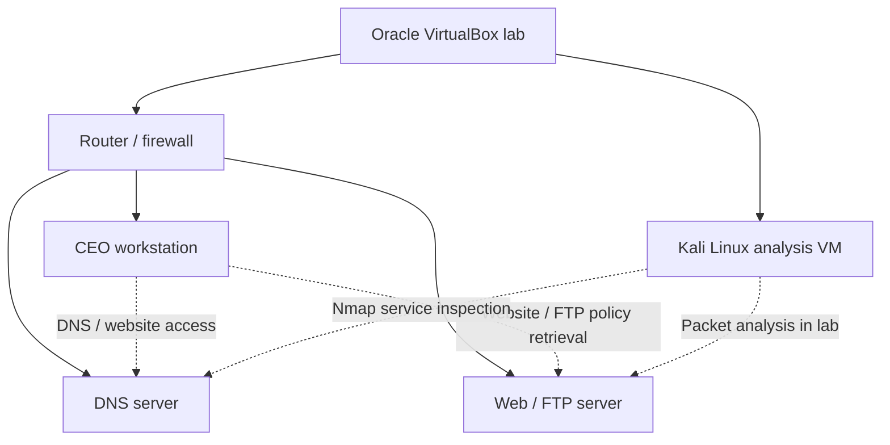

# Lab workflow and architecture — Career Simulation 1

**Source basis:** Submitted QuickStart/UNM project video, supplemented by source-review notes in the private career evidence ledger. This is an explanatory reconstruction, not a new execution of the original VMs.

## Conceptual component map

**Diagram boundary:** A conceptual illustration of the roles shown or described in the video; it is **not** an exact interface, subnet, firewall-rule, or packet-flow specification. The original training diagram remains the authoritative layout.

## Phase 1 — Set up and inspect

- The fictional client needed a network upgrade with limited physical space and budget.
- The exercise used virtual machines, including a workstation, router/firewall and DNS/web service hosts.
- The presentation describes configuration and troubleshooting for the CEO workstation and other lab services.

## Phase 2 — Diagnose connectivity

- A screenshot shows the CEO workstation without expected trusted-network connectivity.
- The recorded workflow checked interface/address information and changed a relevant network connection from manual to automatic DHCP.
- Subsequent presentation evidence showed successful access to the lab website.

**Evidence interpretation:** This documents the troubleshooting sequence shown in training, not proof that every possible network fault was diagnosed or eliminated.

## Phase 3 — Inspect name resolution and services

- A terminal view displays resolver configuration using `/etc/resolv.conf`.
- Nmap was used to inspect exposed ports on the DNS host.
- The video discusses host configuration and service behavior, but does not establish production-grade segmentation verification.

## Phase 4 — File transfer and traffic review

- The workstation retrieved a training policy file from the web server using FTP.
- Wireshark was used to inspect related packet traffic in the controlled lab.
- The exercise illustrates why sensitive transfers should favor encrypted protocols. Avoid reusing sample credentials or publishing unredacted network captures.

## Phase 5 — Security recommendations

As presented in the original submission:
- Patch operating systems and applications regularly.
- Disable unnecessary services to reduce the exposed attack surface.
- Apply role-based permissions.
- Avoid assigning administrative rights to executive user accounts without a justified need.

## What is not established

- No packet-by-packet evidence review or new VirtualBox configuration export was conducted for this GitHub documentation.
- No independently measured network-performance improvement, enterprise rollout, production monitoring, or persistent firewall policy deployment is claimed.
- The public repository intentionally contains no raw source video, VM disks, secret-bearing terminal screenshots, or captures.
